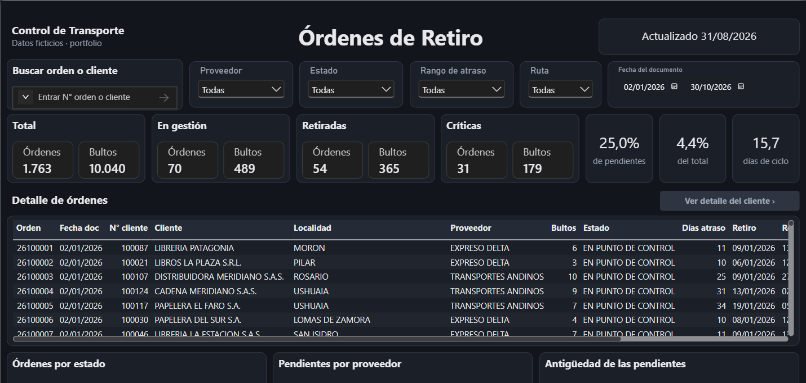
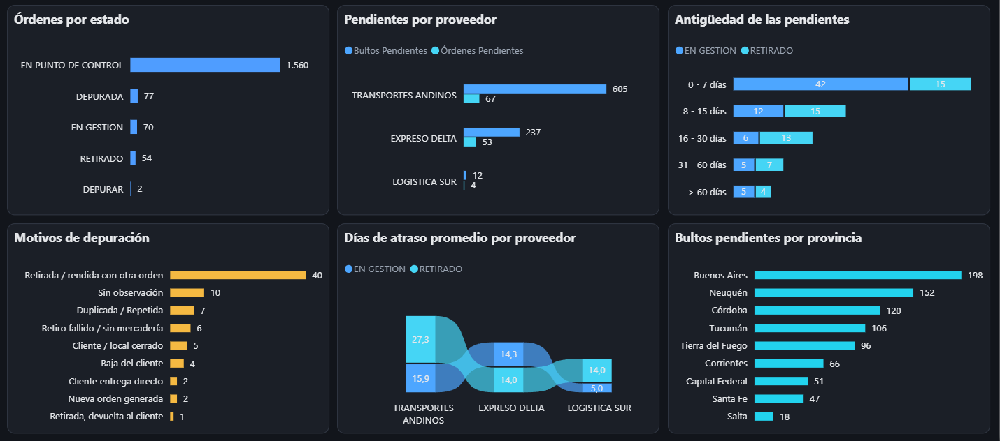
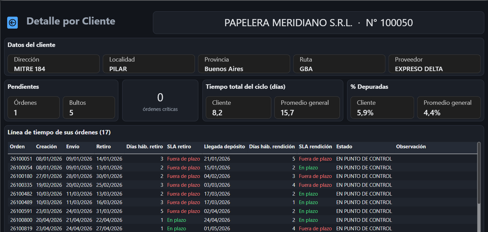
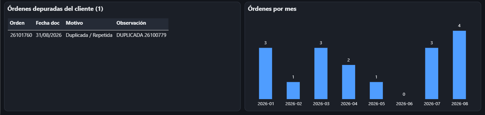
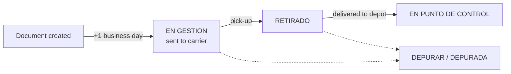

# Logistics Control Tower: Pick-up Orders

**Pick-up order traceability with SLA-based critical orders, daily carrier alerts, SQL KPIs and a Power BI dashboard, built on fictional data.**

When a company asks carriers to collect goods from its customers (returns, damaged goods, overstock), orders get stuck in two places: waiting to be picked up, and picked up but never delivered back to the depot. This project turns the master Excel an operations team works with into three things:
- a daily list of critical orders for each carrier;
- an alert email to each carrier;
- a dashboard for the logistics and sales teams.

It is modelled on a real operation and rebuilt from scratch: the rules, thresholds and volumes are real, while every customer, carrier, address and order is invented.

## What it does

1. **Generates the master Excel** (`data/maestro_ordenes_retiro.xlsx`), with the same 21 columns the operation uses and about 230 orders a month across three carriers.
2. **Applies the business rules** in Python:
   - the sent date and the business days elapsed in each pending status;
   - delay days and delay ranges;
   - critical orders, based on each carrier's SLA;
   - route groups, read from the shipping route code;
   - incident categories, read from free-text notes.
3. **Sends the daily alert:** one email per carrier with its newly critical orders. Those orders are then flagged in the Excel (`Mail = TRUE`), so they are never sent twice.
4. **Loads a star schema** in DuckDB and computes the dashboard KPIs in SQL.
5. **Feeds a Power BI project** (`.pbip`) with a main page, a search box (order number, customer or customer number) and a customer drillthrough page.
6. **Tests every rule:** 60 automated tests, most of them on hand-made orders where each expected value is worked out in a comment.

## Dashboard





**Customer drillthrough:** select an order and click *Ver detalle del cliente*. The page shows the customer's record, cards compared with the overall average, and a timeline of every order with the SLA status of each leg.



Below the timeline come the customer's purged orders, with their reason and note, and orders per month. Months without orders show as zero.



## Order lifecycle and SLA



An order is **critical** when the business days it has spent in a pending status reach its carrier's threshold:

| Carrier | Days to pick up | Days to deliver to the depot | Orders per month |
|---|---:|---:|---:|
| Expreso Delta | 2 | 3 | ~160 |
| Logística Sur | 5 | 7 | ~10 |
| Transportes Andinos | 10 | 15 | ~60 |

Business days skip weekends. Delay days are calendar days from document creation until the order reaches the depot.

## Sample output

Snapshot date 31/08/2026, eight months of data (`python -m lct`, seed 42):

| Total orders | Pending | Critical | % critical (of pending) | % purged | Avg cycle time |
|---:|---:|---:|---:|---:|---:|
| 1,763 | 124 | 31 | 25.0% | 4.4% | 15.7 days |

## Quick start

Requires Python 3.11+.

```bash
git clone https://github.com/JuanCamellini/logistics-control-tower.git
cd logistics-control-tower
python -m venv .venv
.venv\Scripts\activate          # Windows
# source .venv/bin/activate     # macOS / Linux
pip install -r requirements.txt

python -m lct                   # generate -> alerts -> build -> kpis -> export
pytest                          # 60 tests
```

Then open `powerbi/OrdenesRetiro.pbip` in Power BI Desktop ([guide](powerbi/README.md)).

| Output | Content |
|---|---|
| `data/maestro_ordenes_retiro.xlsx` | Master Excel (fictional) |
| `output/alerts/*.html` | One alert email per carrier (in Spanish) and a summary |
| `output/warehouse.duckdb` | Star schema |
| `output/kpis/*.csv` | Result of each KPI query |
| `output/powerbi/*.csv` | Tables read by the Power BI project |

## Project structure

```
lct/
  config.py      carriers, SLAs, volumes, master Excel columns
  rules.py       business rules (business days, critical orders, delay, routes, incident categories)
  generate.py    fictional master Excel
  alerts.py      daily email per carrier, flags notified orders
  warehouse.py   star schema in DuckDB, KPI queries, export for Power BI
sql/
  schema.sql     star schema DDL
  kpis/          one query per dashboard card or chart
powerbi/         Power BI project (TMDL model + PBIR report) and tools/ to rebuild and validate it
tests/           pytest suite
```

## Design decisions

- **Rules live in Python, not in DAX.** Critical orders, delays and incident categories are computed once and tested. Power BI and the alert emails read the same values, so they never disagree.
- **The alert only sends new critical orders.** The `Mail` column works as a notification log: an order is emailed the first day it becomes critical and never again.
- **Fixed snapshot date.** The data is judged as of a set date, so every run gives the same results.
- **Portable SQL.** The queries use standard SQL (`COUNT(*) FILTER (WHERE ...)`, `NULLIF`, `CASE` ordering) that also runs on PostgreSQL.
- **Power BI as text.** The `.pbip` format keeps the model and every visual as JSON/TMDL files that can be reviewed in a pull request.

## Roadmap

- [ ] Send the alert emails through SMTP
- [ ] Delivery traceability (delivery notes and proof of delivery) as a second module
- [ ] Freight invoice audit: billed amounts vs. the carrier's rate card

## Resumen en español

Trazabilidad de órdenes de retiro con datos ficticios. Genera el Excel maestro con las mismas 21 columnas de la operación real y calcula en Python los días hábiles, los días de atraso, las órdenes críticas según el SLA de cada proveedor, la ruta y la categoría de incidencia. Manda un mail diario a cada proveedor con sus críticas nuevas y alimenta un tablero de Power BI con una página principal y otra de detalle por cliente.

## Author

**Juan Tomas Camellini**, Data & Operations Analyst · [LinkedIn](https://www.linkedin.com/in/juancamellini) · [GitHub](https://github.com/JuanCamellini)
